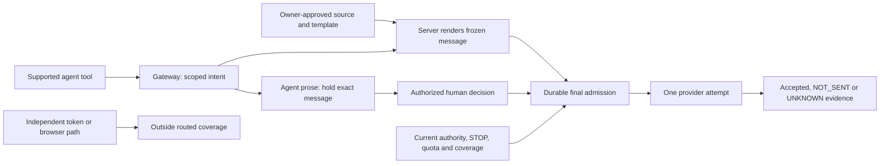

# SpeedWrit action gateway build packet

Proposed contract and backlog, 12 October 2026. This documentation does not enable a feature or resume the held phone demonstration. P00–P25 are planning IDs, not opened GitHub PRs.

The next build is one approved factsheet → Dana Gmail workflow. The server selects the owner-approved source and template, freezes the complete message and checks current authority before one provider attempt. Every agent-written message requires approval of its exact frozen content.

| Read | Purpose |
| --- | --- |
| [Specification](specification.md) | Coverage, approved sources, content modes, immutable authority, concurrency, approval, tenant boundaries and release gates |
| [Research reconciliation](research-review.md) | Full-input provenance, accepted and rejected recommendations, primary citations and competitor corrections |
| [PR plan and backlog](pr-plan.md) | P00–P25 dependencies, bounded deliverables, failing proof tests, review partners and merge versus activation boundaries |

## Where enforcement sits

A conventional `send_email` tool can execute through the gateway without the user naming SpeedWrit. An independently authorized native connector does not pass through this tool. Broader coverage requires verified control of credentials, runtime routes and applicable administrator restrictions; see the specification's coverage matrix.

## First implementation waves

| Wave | Planned work | Required outcome |
| --- | --- | --- |
| Contract | P00; P14 enterprise contracts in parallel | Agree on enforceable scope and explicit exclusions |
| Foundations | P01 replay conflicts; P02–P05 approved sources, authority and mandatory prose holds; P06–P07 durable admission; P11 operations | No legacy route bypass, no second attempt across revisions, no replica startup/control gap |
| Review and evidence | P08 UI, P09 approval, P10 receipts, P23a minimum privacy | Owner sees and approves the same authority and bytes that execute |
| Narrow release | P12 guarded activation, then P13 measured pilot | One fresh authorized source-bound workflow, with meaningful failure and uncertainty proof |
| Later profiles | P15–P18 enterprise; P19–P21 controlled routes/credentials; P22–P24 scale and operations; P25 new-operation contracts | Each expanded claim earns its own proof and rollout |

All source-mode provider admission stays disabled before P12, including approval and worker paths. Activation also closes legacy admission for the covered actor/account/connection scope. Historical signed objects remain unchanged. UNKNOWN keeps its reservation and never automatically resends.

## Team claims and open lanes

G1 authors the packet and coordinates live operations. Warden has claimed packet/all-path review. Firepower has claimed bounded source-to-render-to-approval and identity/UNKNOWN review. Gx has supplied a proposed enterprise B0 browser contract and offered bounded UI/API review. These are review contributions, not implementation assignments or acceptance keys.

Source/data, executor, concurrency, G4 owner UI, approval, evidence/privacy, infrastructure and enterprise implementation lanes remain open. Claim one bounded deliverable with its files, dependencies and a non-author reviewer in Senti using the formats in the PR plan. Avoid overlapping source ownership; root remains the sole live operator and Warden the merger.

The research supports free useful enforcement with paid operations and intelligence. It does not support default customer-content harvesting, claims of universal interception, or an unmeasured enterprise-readiness or scale promise.
